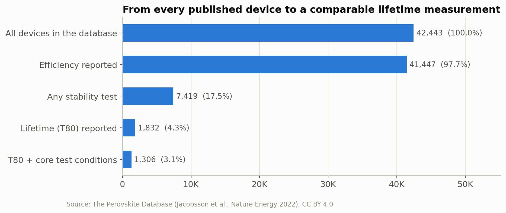
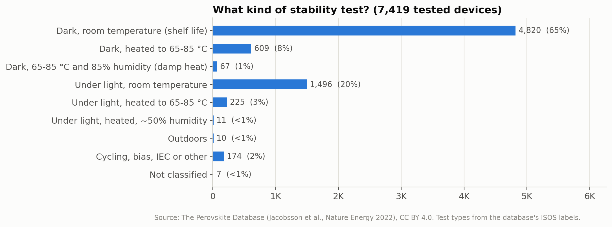
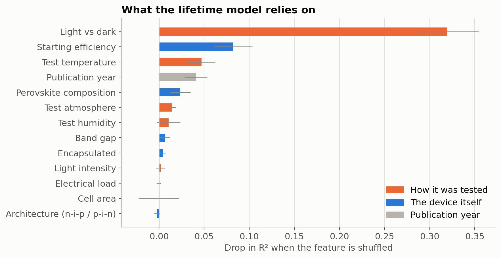
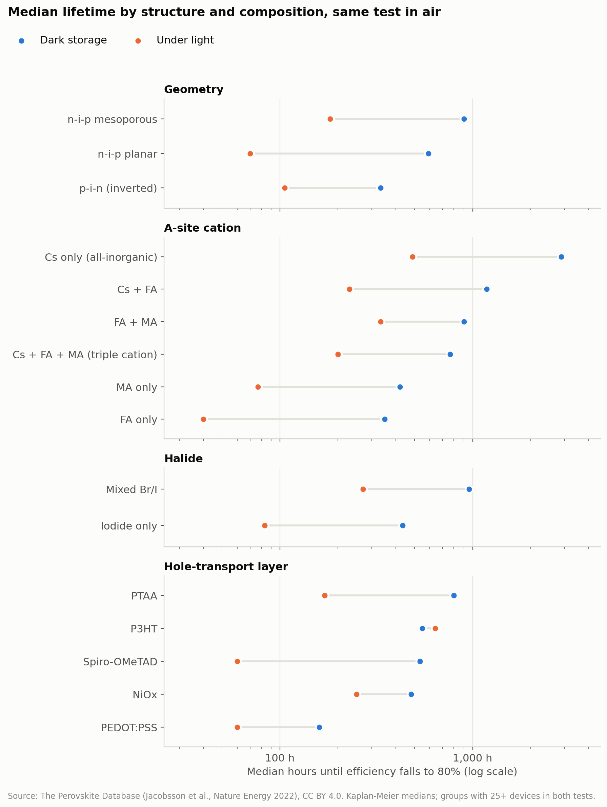
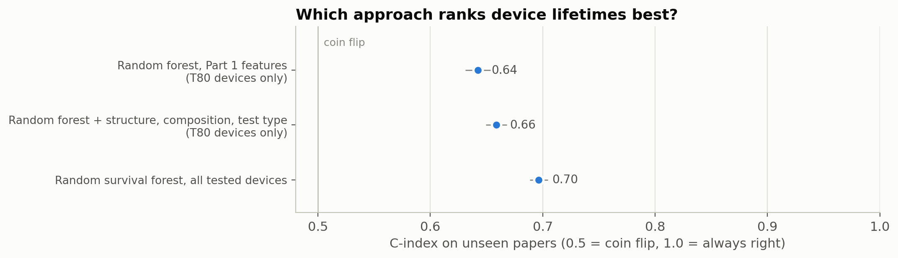
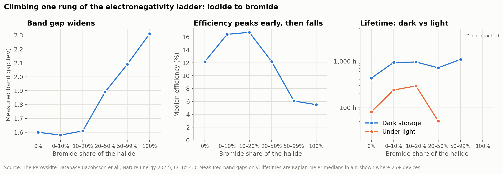
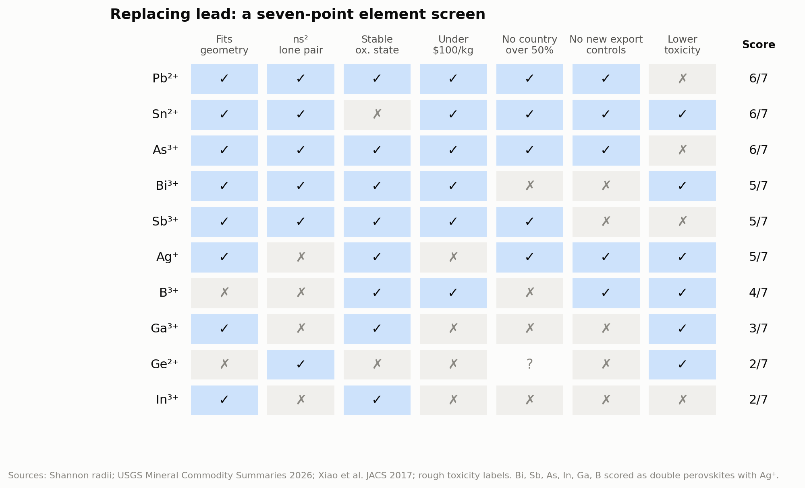
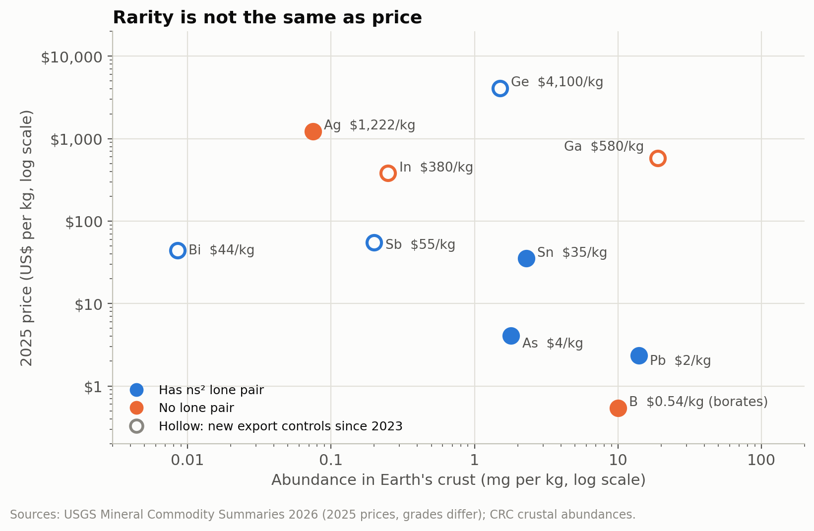
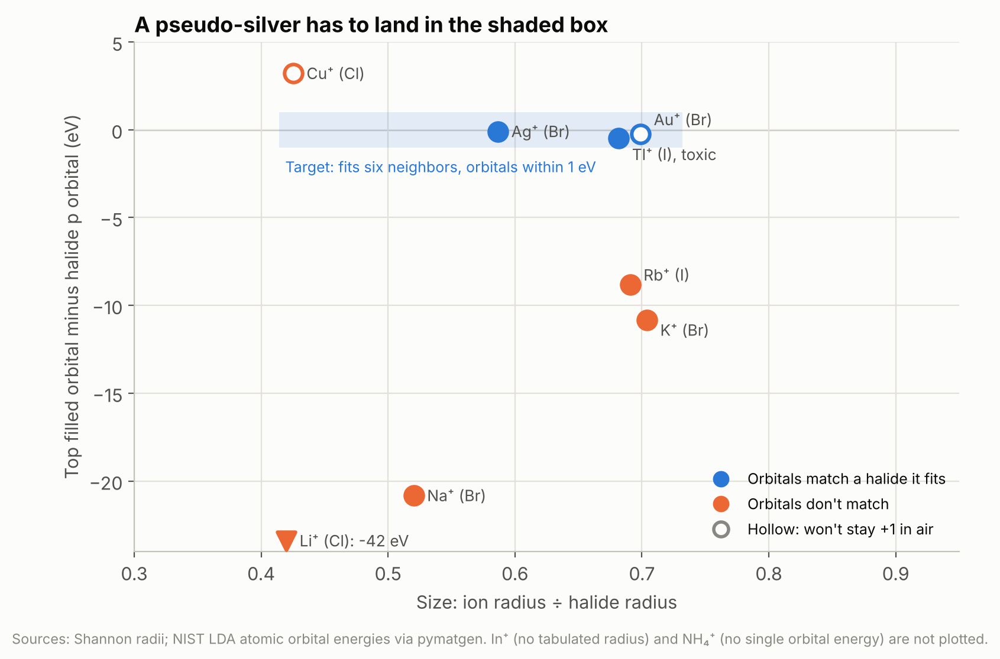
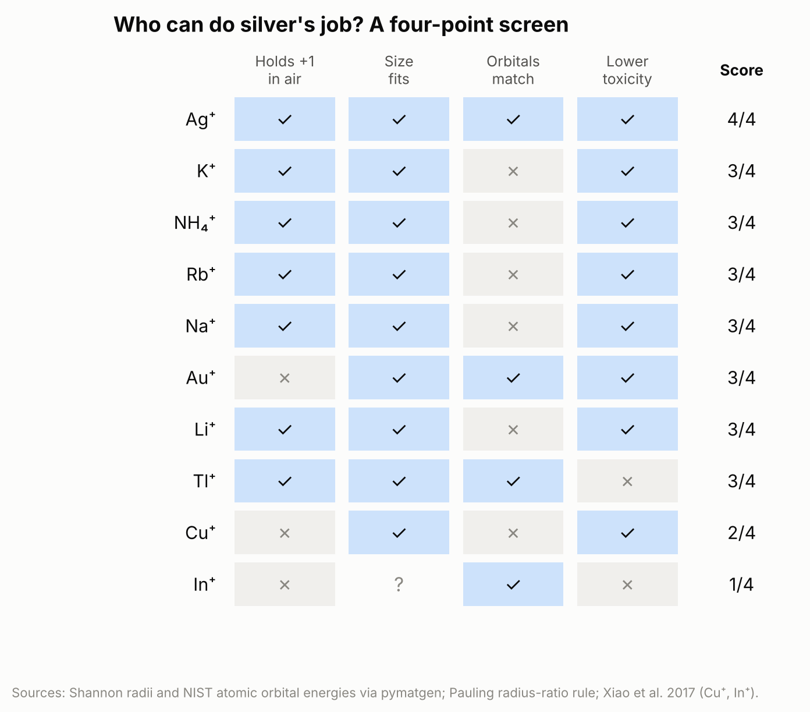

# Mind the Stability Gap

**How much of the perovskite solar cell literature actually measures lifetime?**

Perovskite solar cells went from under 4% efficiency in 2009 to over 25% about a decade later, yet they still aren't on rooftops at scale. The usual explanation is stability. This project uses the open [Perovskite Database](https://www.perovskitedatabase.com/), which covers 42,443 devices from 7,358 papers, to measure how often the literature reports lifetime, what kinds of tests sit behind those numbers, and whether machine learning can learn lifetime from them.

I come from university technology transfer, where the first question a licensee asks about a new material is "how long does it last?" This project checks how often the published record can answer that.

## Key findings

1. **Lifetime is rarely reported.** Efficiency is reported for 98% of devices, but only 17.5% have any stability test, and only **1,832 devices (4.3%)** report a lifetime (T80, the hours until efficiency falls to 80% of its starting value). Stability testing grew from 3% of devices in 2013 to 23% in 2019, but T80 reporting only reached 6%.
2. **Most "stability tests" are shelf-life tests.** **65%** of tests store the cell in the dark at room temperature. Only 1% resemble the damp-heat conditions (85 °C, 85% humidity) used in product certification, and only 7% ran under light with maximum-power-point tracking, which is how a panel actually operates.
3. **The most stable devices are invisible.** T80 only exists if a device loses 20% of its efficiency before the test ends. **3,133 tested devices (42%)** outlasted their test, so they have no T80. A model trained on T80 sees only the devices that failed. Another 2,408 (32%) fell below 80% but had no T80 recorded.
4. **Machine learning mostly learns the test, not the material.** A random forest scores R² = 0.34 when devices are split at random, but **0.12 when whole papers are held out**. That's a typical error of about ×4.4, versus ×5.0 for simply guessing the median. The learning curve is flat, so more data of the same quality won't fix it. The strongest predictor of lifetime is **whether the test was run in light or dark**, and test conditions account for **72%** of what the model relies on.

**Takeaway:** the bottleneck for using ML on perovskite stability isn't the amount of data. It's how lifetime is measured and reported. Standardized tests (ISOS / IEC 61215) and survival-style reporting, which records "still working at hour X" instead of leaving it blank, would make the literature far more useful to modelers and to the people deciding what to commercialize.

## Part 2: structure, composition, and better models

Part 2 compares groups **within the same test**: dark storage in air (ISOS-D-1) and light soaking in air (ISOS-L-1). It uses Kaplan–Meier survival curves so devices that outlasted their test still count.

1. **Composition matters once the test is held fixed.** In dark storage, median lifetimes range from 350 h (FA only) to 2,880 h (Cs only, all-inorganic). Under light, they range from 40 h to 486 h for the same two groups. MA-only cells, which make up two-thirds of the database, are among the shortest-lived (420 h dark, 77 h light).
2. **Mixing helps.** Mixed-cation (FA + MA, Cs + FA, triple cation) and mixed-halide (Br/I) cells last roughly 2–4× longer than MA-only or iodide-only cells in both tests.
3. **The winner depends on the test.** Light cuts Spiro-OMeTAD cells' lifetime about 9× (533 h to 60 h) but NiOx cells' only about 2× (480 h to 250 h). The ranking you'd pick from dark-storage data isn't the ranking under light.
4. **Better statistics beat more features.** Training a *random survival forest* on all 7,358 tested devices, instead of only the 1,832 with a T80, raised the C-index from 0.64 to 0.70 on unseen papers. Adding structure and composition features raised R² only from 0.14 to 0.18, about the size of the run-to-run noise. Separate models per test type did worse.

These are associations from published data, not controlled experiments. Newer recipes may also benefit from better processing.

## Part 3: the electronegativity ladder, and where boron fits

The X-site anion works like a dial. Less electronegative anions like iodide give small band gaps, which is good for absorbing sunlight, but soft bonds. More electronegative ones hold their electrons tighter.

1. **The field has barely turned the dial.** 99.6% of devices use only iodide and/or bromide at the X-site. Pseudohalides like SCN⁻, PF₆⁻, and the boron-containing BF₄⁻ appear in about a dozen devices each.
2. **The band gap follows electronegativity.** Measured gaps rise from 1.60 eV with pure iodide to 2.31 eV with pure bromide. Efficiency peaks at up to about 20% bromide, then falls.
3. **Mixing anions is not a free lunch.** In dark storage, adding bromide roughly doubles median lifetime (432 h to 960 h). Under light, 10–20% bromide lasts longest (293 h), but 20–50% bromide fails fastest (52 h, from only 27 devices). That's consistent with light-induced halide segregation, where mixed iodide/bromide films un-mix under illumination.
4. **Boron fits geometrically.** Borohydride (BH₄⁻) has a tolerance factor of 0.92 with MA⁺ and Pb²⁺, right between bromide and iodide. Perovskite-type borohydrides exist, but BH₄⁻ is a strong reducing agent. Boron's strength in energy materials is as the core of charge-diffuse cluster anions: closo-borate and carborane solid electrolytes, BF₄⁻ additives, and, in silicon solar, a cautionary tale. The boron–oxygen defect drove the industry to switch to gallium doping after 2020.

## Part 4: an element screen for replacing lead

Ten candidate metals are scored on seven pass/fail checks: geometric fit, an ns² lone pair, oxidation-state stability, price, supply concentration, new export controls, and toxicity. Prices and supply data come from the USGS *Mineral Commodity Summaries 2026*.

1. **Lead, tin, and arsenic tie at 6/7, and each fails on something serious.** Lead and arsenic are toxic, and tin oxidizes from Sn²⁺ to Sn⁴⁺. Bismuth and antimony double perovskites come next but carry supply risk.
2. **Rarity is not the same as price.** Gallium is more common in Earth's crust than lead but costs about 250× more, because it's a byproduct of aluminum production and China produces ~99% of it. Arsenic and germanium are about equally common, yet germanium costs ~1,000× more.
3. **Five of the ten candidates came under new Chinese export controls between 2023 and 2025:** germanium, gallium, antimony, indium, and bismuth.
4. **Boron fails the geometry at every halide.** It's too small for the octahedral cage.

## Part 5: a silver-mimic screen

Bismuth can't replace lead alone. Bi³⁺ pairs with a +1 ion, usually silver, as in Cs₂AgBiBr₆. Part 5 asks which other +1 ions could do silver's job, scoring ten candidates (alkali metals, copper, gold, In⁺, Tl⁺ and ammonium) on four checks: holding +1 in air, fitting the six-neighbor site (Pauling's radius-ratio rule and the tolerance factor), matching the halide's orbital energy (NIST atomic orbital energies via pymatgen), and toxicity.

1. **Silver's advantage is an energy coincidence.** Its filled 4d shell sits within 0.1 eV of bromine's 4p, so silver's electrons join the valence band. Copper's 3d sits about 2.5 eV higher, which is why copper won't take six neighbors.
2. **Silver is the only ion that passes all four checks.** Sodium, potassium, rubidium, lithium and ammonium hold +1 and fit, but their top electrons sit 8–43 eV too deep to carry charge. Gold matches but won't stay +1; thallium matches but is toxic. The result holds for any orbital window from 0.5 to 3.2 eV.
3. **The track record agrees.** Silver appears in 125 lead-free devices in the database; potassium, rubidium and ammonium appear only at the A-site, never in silver's role, and the single sodium device (Cs₂NaBiI₆) reached 0.42%.
4. **A tin-based +1 unit is real chemistry but can't live in a perovskite.** [Sn–R]⁺ keeps tin's lone pair (a pseudo-In⁺), but its partner would take a halide's place, and sodium pushes tin the wrong way (tin–sodium compounds hold *negative* tin). That points toward new frameworks, such as vacancy-ordered Cs₂SnI₆, where tin sits in its preferred 4+ state.

## Run it yourself

Click either **Open in Colab** button above, then choose **Runtime → Run all**. Each notebook downloads the data from Zenodo automatically and finishes in about two to three minutes. Results can shift slightly (for example R² 0.12–0.14) depending on library versions and how papers are split.

| File | What it is |
|---|---|
| `perovskite_stability_gap.ipynb` | Part 1: download, cleaning, gap analysis, lifetime model |
| `02_structure_composition_and_better_models.ipynb` | Part 2: breakdown by structure and composition, survival analysis, model improvements |
| `03_electronegativity_ladder_and_boron.ipynb` | Part 3: X-site anion chemistry, iodide-to-bromide trade-off, tolerance factors, boron |
| `04_element_screen.ipynb` | Part 4: scoring candidate metals on geometry, electronics, economics, and safety |
| `05_silver_mimic_screen.ipynb` | Part 5: which +1 ions could do silver's job, a tin-based +1 unit, and alternative frameworks |
| `figures/` | All sixteen charts as PNGs |
| `stability_gap_summary.csv`, `part2_summary.csv` … `part5_summary.csv` | Headline numbers |

## Data and citation

Perovskite Database CSV snapshot v1.0.1 (January 2022), licensed CC BY 4.0. Papers were mostly published between 2013 and 2019, with partial coverage of 2020.

- Jacobsson, T.J. *et al.* An open-access database and analysis tool for perovskite solar cells based on the FAIR data principles. *Nature Energy* 7, 107–115 (2022). [doi:10.1038/s41560-021-00941-3](https://doi.org/10.1038/s41560-021-00941-3)
- Data archive: [doi:10.5281/zenodo.5834698](https://doi.org/10.5281/zenodo.5834698)
- ISOS test definitions: Khenkin, M.V. *et al.* Consensus statement for stability assessment and reporting for perovskite photovoltaics based on ISOS procedures. *Nature Energy* 5, 35–49 (2020). [doi:10.1038/s41560-019-0529-5](https://doi.org/10.1038/s41560-019-0529-5)
- Part 3: Kieslich, Sun & Cheetham, *Chem. Sci.* 2015 ([doi:10.1039/c5sc00961h](https://doi.org/10.1039/c5sc00961h)); Schouwink *et al.*, *Nat. Commun.* 2014 ([doi:10.1038/ncomms6706](https://doi.org/10.1038/ncomms6706)); Hoke *et al.*, *Chem. Sci.* 2015 ([doi:10.1039/c4sc03141e](https://doi.org/10.1039/c4sc03141e))
- Part 4: U.S. Geological Survey, *Mineral Commodity Summaries 2026*; Shannon, *Acta Cryst.* A32 (1976); Ganose, Savory & Scanlon, *Chem. Commun.* 2017 ([doi:10.1039/c6cc06475b](https://doi.org/10.1039/c6cc06475b)); Xiao *et al.*, *JACS* 139 (2017)
- Part 5: Shannon (1976) radii and NIST Atomic Reference Data (SRD 141) orbital energies, both via pymatgen; Pauling, *J. Am. Chem. Soc.* 51, 1010 (1929); Kieslich, Sun & Cheetham, *Chem. Sci.* 2015; Xiao *et al.*, *Angew. Chem.* 2017 and *Mater. Horiz.* 2017 ([doi:10.1039/C6MH00519E](https://doi.org/10.1039/C6MH00519E)); Luo *et al.*, *Nature* 563 (2018) ([doi:10.1038/s41586-018-0691-0](https://doi.org/10.1038/s41586-018-0691-0)); Lee *et al.*, *JACS* 136, 15379 (2014) ([doi:10.1021/ja508464w](https://doi.org/10.1021/ja508464w)); Jutzi & Burford, *Chem. Rev.* 99, 969 (1999). Full list in the notebook.
- Builds on: *The challenge of studying perovskite solar cells' stability with machine learning*, Frontiers in Energy Research (2023). [doi:10.3389/fenrg.2023.1118654](https://doi.org/10.3389/fenrg.2023.1118654)

### Presentation sources

Numbered to match the citation footers and the Sources slide in the class presentation.

1. Kojima, A. *et al.* Organometal halide perovskites as visible-light sensitizers for photovoltaic cells. *J. Am. Chem. Soc.* 131, 6050–6051 (2009). [doi:10.1021/ja809598r](https://doi.org/10.1021/ja809598r)
2. NREL, [Best Research-Cell Efficiency Chart](https://www.nrel.gov/pv/cell-efficiency.html)
3. Jacobsson, T.J. *et al.* *Nature Energy* 7, 107–115 (2022). [doi:10.1038/s41560-021-00941-3](https://doi.org/10.1038/s41560-021-00941-3)
4. Khenkin, M.V. *et al.* *Nature Energy* 5, 35–49 (2020). [doi:10.1038/s41560-019-0529-5](https://doi.org/10.1038/s41560-019-0529-5)
5. IEC 61215-2:2021, Terrestrial photovoltaic modules: design qualification and type approval, Part 2: Test procedures
6. Ishwaran, H. *et al.* Random survival forests. *Ann. Appl. Stat.* 2, 841–860 (2008). [doi:10.1214/08-AOAS169](https://doi.org/10.1214/08-AOAS169)
7. Kaplan, E.L. & Meier, P. Nonparametric estimation from incomplete observations. *J. Am. Stat. Assoc.* 53, 457–481 (1958). [doi:10.1080/01621459.1958.10501452](https://doi.org/10.1080/01621459.1958.10501452)
8. Hoke, E.T. *et al.* *Chem. Sci.* 6, 613–617 (2015). [doi:10.1039/c4sc03141e](https://doi.org/10.1039/c4sc03141e)
9. Shannon, R.D. Revised effective ionic radii. *Acta Cryst.* A32, 751–767 (1976). [doi:10.1107/S0567739476001551](https://doi.org/10.1107/S0567739476001551)
10. Ganose, A.M., Savory, C.N. & Scanlon, D.O. *Chem. Commun.* 53, 20–44 (2017). [doi:10.1039/c6cc06475b](https://doi.org/10.1039/c6cc06475b)
11. Xiao, Z. *et al.* Intrinsic instability of Cs₂In(I)M(III)X₆ double perovskites. *J. Am. Chem. Soc.* 139, 6054 (2017)
12. U.S. Geological Survey, [*Mineral Commodity Summaries 2026*](https://pubs.usgs.gov/publication/mcs2026)
13. *CRC Handbook of Chemistry and Physics*, Abundance of elements in the Earth's crust
14. IDTechEx, [*Barrier Films for Flexible Electronics 2011–2021*](https://www.idtechex.com/research-report/barrier-films-for-flexible-electronics-2011-2021/267) (2011)
15. Shi, L. *et al.* Gas chromatography–mass spectrometry analyses of encapsulated stable perovskite solar cells. *Science* 368, eaba2412 (2020). [doi:10.1126/science.aba2412](https://doi.org/10.1126/science.aba2412)
16. Martins, J. *et al.* Novel laser-assisted glass frit encapsulation for long-lifetime perovskite solar cells. *J. Mater. Chem. A* 8, 20037–20046 (2020). [doi:10.1039/D0TA05583B](https://doi.org/10.1039/D0TA05583B)
17. Sekisui Chemical: [bendable perovskite mass production](https://www.perovskite-info.com/sekisui-chemical-mass-produce-bendable-perovskite-solar-cells) (2023); [SOLAFIL launch](https://www.perovskite-info.com/sekisui-chemical-and-ssf-launch-solafil-film-type-perovskite-solar-cells) (2026)
18. Panasonic, [glass perovskite PV](https://perovskite-pv.panasonic.com/en/value)
19. [GCL secures perovskite module certification for 3x IEC accelerated aging tests](https://www.perovskite-info.com/gcl-secures-perovskite-module-certification-3x-iec-accelerated-aging-tests) (2025)
20. [Ergis readies a novel encapsulation film for perovskite solar panels](https://www.perovskite-info.com/ergis-readies-novel-encapsulation-film-perovskite-solar-panels) (sponsored, 2023)
21. [Toray develops super high barrier film](https://qmed.com/toray-develops-super-high-barrier-film-offering-news117448.html) (2022)
22. [Quanex releases solar panel sealant for improved durability](https://pv-magazine-usa.com/2022/08/10/quanex-releases-solar-panel-sealant-for-improved-durability/) (2022)
23. Castro-Hermosa, S. *et al.* Quantifying performance of permeation barrier–encapsulation systems for flexible and glass-based electronics and their application to perovskite solar cells. *Adv. Electron. Mater.* 5, 1800978 (2019). [doi:10.1002/aelm.201800978](https://doi.org/10.1002/aelm.201800978)
24. [Halocell, Australian researchers to scale lead-free solar tech](https://www.pv-magazine.com/2025/05/14/halocell-australian-researchers-to-scale-lead-free-solar-tech/) (2025)
25. [Perovskite may leak less lead than lead-solder silicon, say scientists](https://www.pv-magazine.com/2026/10/05/perovskite-may-leak-less-lead-than-lead-solder-silicon-say-scientists/) (2026), on *Overstated Lifecycle Lead Risks of Perovskite Solar Cells and the Hidden Transboundary Displacement*, *Environ. Sci. Technol.*
26. Babayigit, A. *et al.* Assessing the toxicity of Pb- and Sn-based perovskite solar cells in model organism *Danio rerio*. *Sci. Rep.* 6, 18721 (2016). [doi:10.1038/srep18721](https://doi.org/10.1038/srep18721)
27. Fraunhofer ISE, [47.6 percent world record solar cell](https://www.ise.fraunhofer.de/content/dam/ise/en/documents/press-releases/2022/1322_PR_ISE_World_Record_47,6Percent-SolarCell.pdf) (2022)
28. ECHA Committee for Risk Assessment, [Opinion on gallium arsenide](https://www.echa.europa.eu/documents/10162/17233/gallium_arsenide_opinion_en.pdf) (2011)
29. Chen, B. *et al.* Recycling lead and transparent conductors from perovskite solar modules. *Nat. Commun.* 12 (2021). [doi:10.1038/s41467-021-26121-1](https://doi.org/10.1038/s41467-021-26121-1)
30. First Solar, [module recycling](https://www.firstsolar.com/Global/Archive/Home/Modules/Recycling)
31. Grandhi, G.K. *et al.* Silver–bismuth perovskite-inspired materials: chemistry, optoelectronic properties, and emerging applications in photovoltaics and beyond. *J. Mater. Chem. A* (2025). [doi:10.1039/D5TA06180F](https://doi.org/10.1039/D5TA06180F)
32. Volonakis, G. *et al.* Lead-free halide double perovskites via heterovalent substitution of noble metals. *J. Phys. Chem. Lett.* 7, 1254 (2016). [arXiv:1603.01585](https://arxiv.org/abs/1603.01585)
33. Xiao, Z. *et al.* Chemical origin of the stability difference between copper(I)- and silver(I)-based halide double perovskites. *Angew. Chem. Int. Ed.* 56 (2017). [OSTI 1533112](https://www.osti.gov/biblio/1533112)
34. Kotochigova, S. *et al.* [Atomic Reference Data for Electronic Structure Calculations](https://www.nist.gov/pml/atomic-reference-data-electronic-structure-calculations), NIST Standard Reference Database 141 (LDA orbital energies of neutral atoms), via pymatgen
35. Pauling, L. The principles determining the structure of complex ionic crystals. *J. Am. Chem. Soc.* 51, 1010 (1929). [doi:10.1021/ja01379a006](https://doi.org/10.1021/ja01379a006)
36. Saidaminov, M.I. *et al.* Conventional solvent oxidizes Sn(II) in perovskite inks. *ACS Energy Lett.* 5, 1153 (2020). [doi:10.1021/acsenergylett.0c00402](https://doi.org/10.1021/acsenergylett.0c00402)

## Limitations

- The data stops in 2020, before the ISOS consensus statement had time to spread. Reporting may have improved since.
- Many values were read by hand off published figures.
- Papers tend to report their best devices.
- The test-type labels (ISOS categories) were assigned by the database curators, not necessarily by the original authors.
- About 70% of tests list exactly 25 °C, and some of those are likely "room temperature" written as 25.

## Research ideas (parked for later)

Questions this project raised that need calculations or lab work to answer:

- **A pseudo-silver.** Is there a cheap, stable +1 ion, cluster or molecule that lands in Part 5's target box: right size for six neighbors, top filled orbital within about 1 eV of the halide's p orbital? A computational screen of molecular cations could test this.
- **Protecting Sn²⁺ from the inside.** Additives that donate electron density to Sn²⁺ are the most-studied way to slow its oxidation, but not every electron-rich molecule helps: DMSO oxidizes Sn(II) when heated (Saidaminov *et al.*, 2020). Which donors protect tin without oxidizing it?
- **Oxygen-rated seals.** Barrier suppliers publish water leak rates; tin needs an oxygen leak rate at or past OLED grade. Could an OLED-grade seal plus a protective additive make tin viable, starting with indoor devices that are already sealed?
- **New frameworks.** A tin atom holding one partner, [Sn–R]⁺, keeps its lone pair but can't fit a perovskite. Vacancy-ordered Cs₂SnI₆ (tin at +4) and rock-salt AgBiS₂ show that other geometries can sidestep a constraint. Which framework keeps charge paths connected in 3D while giving tin or bismuth a site it likes?
- **Tin recycling.** Lead can be recovered from used perovskite modules at 99.2% in the lab; I found no equivalent study for tin.

## Next steps

- Re-run on newer literature using [PERLA](https://arxiv.org/abs/2601.17807), an LLM-updated version of this database in NOMAD, to see whether reporting improved after 2020.
- Compare publication trends with stability-related patent filings on [Lens.org](https://www.lens.org/).

---

*By James Fox for Intro to AI & Machine Learning (CUNY, Fall 2026). Code and analysis were developed with help from Claude (Anthropic), and all figures and numbers were generated by the notebook from the source data.*
