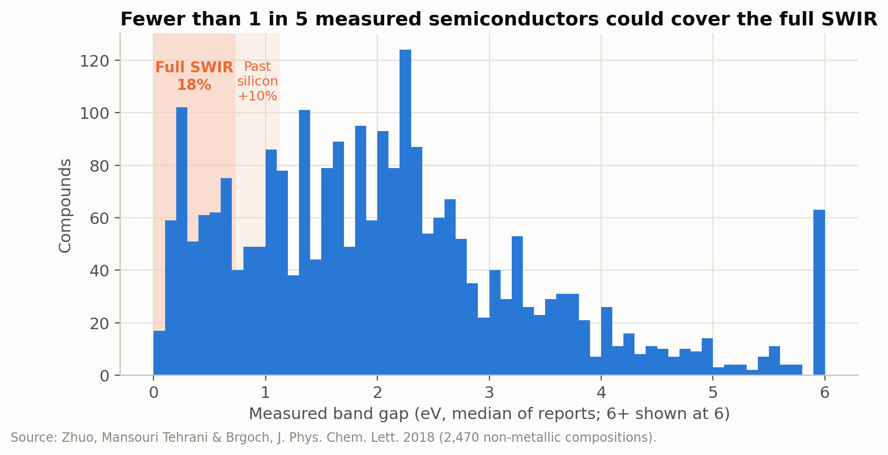
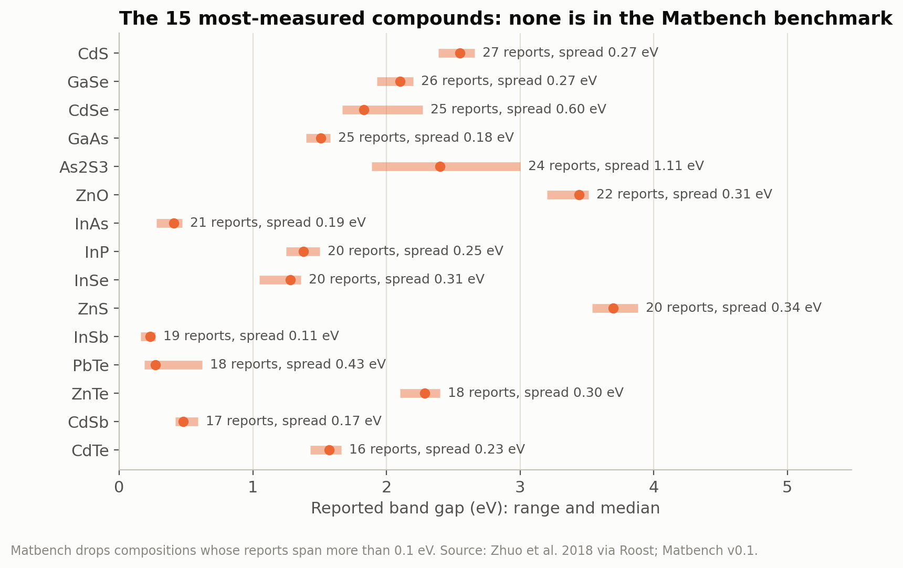
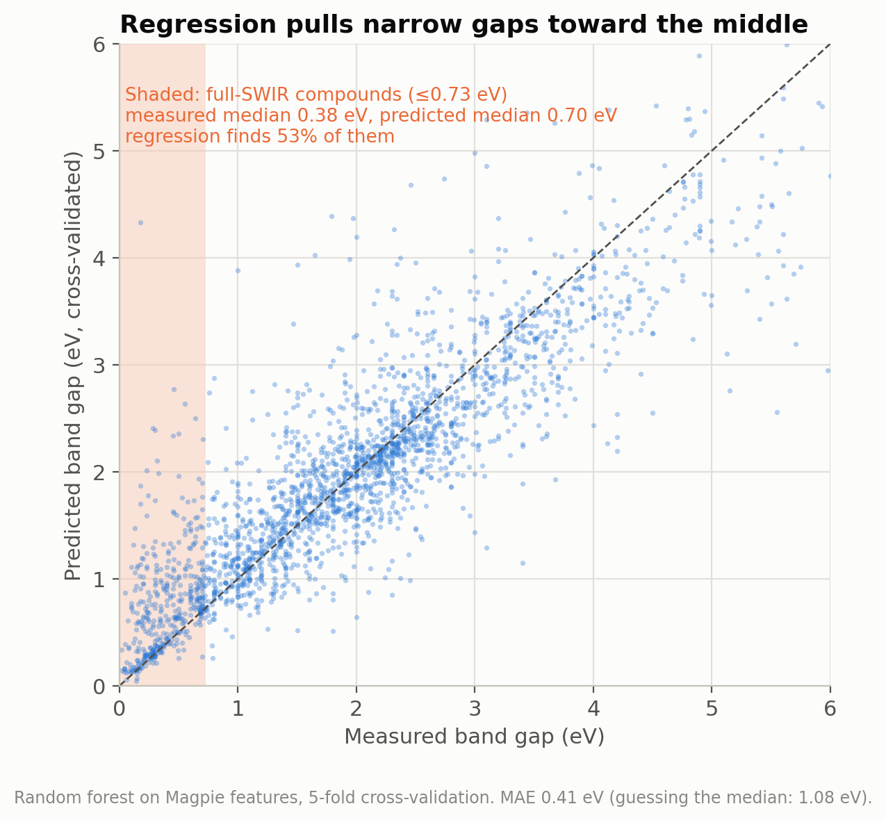
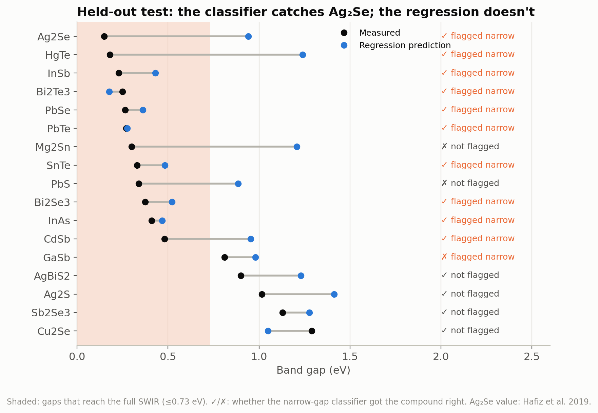
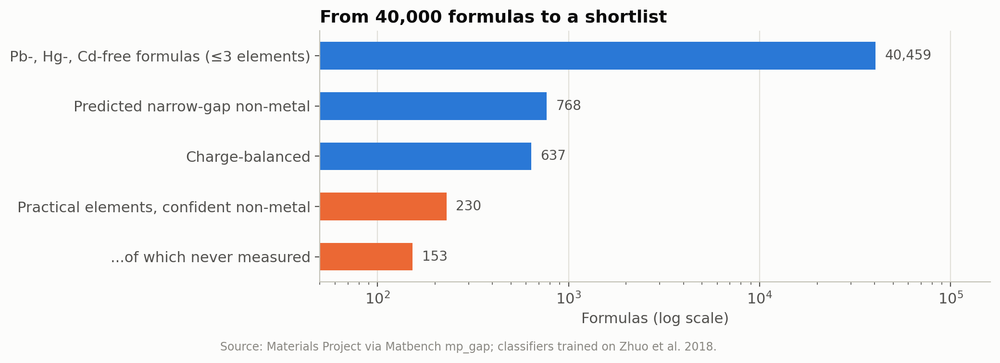
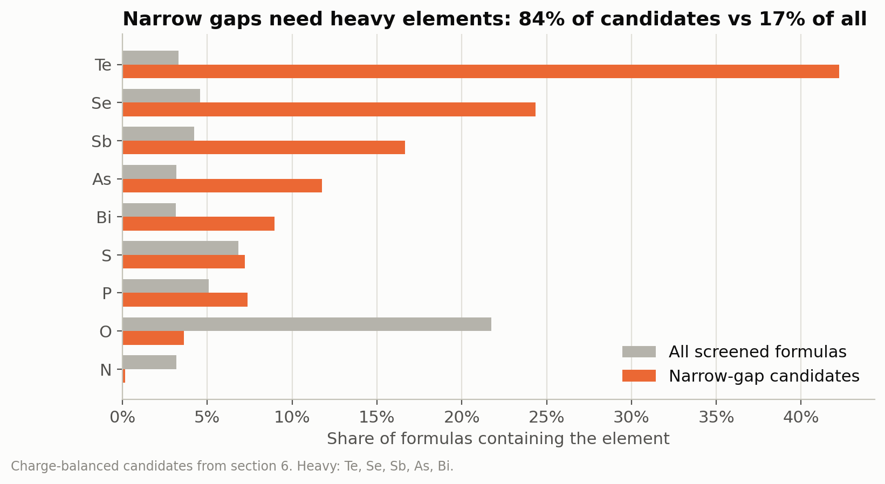
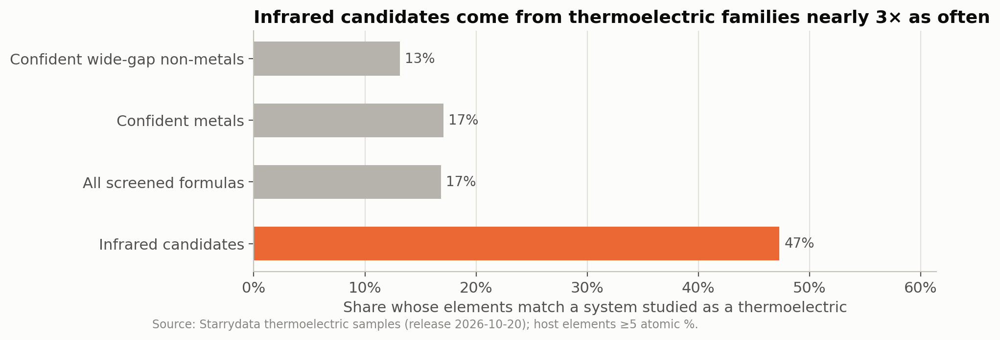

# 03 · Seeing Past Silicon

**A machine-learning screen for lead-free infrared absorbers**

Silicon stops absorbing light at about 1100 nm. Cameras that see past that edge, in the short-wave infrared (SWIR), are used for night vision, machine vision and imaging through haze. Quantum dots coated straight onto silicon readout chips are a cheaper way to build them than today's indium gallium arsenide sensors. But the best quantum dots so far contain lead or mercury, which the EU's RoHS rules restrict. Two lead-free contenders are getting attention: InAs (imec, 2026) and Ag₂Se (Sahu group, NYU, 2025).

This project asks which heavy-metal-free materials could absorb past silicon's edge, how well machine learning can find them from a chemical formula alone, and how Ag₂Se and InAs compare once supply and regulation are counted.

**The rule behind the screen:** shrinking a crystal into a quantum dot can only raise its band gap. So the bulk gap is a hard floor: it must be below 1.13 eV to absorb past silicon, and below 0.73 eV to cover the whole SWIR band out to 1700 nm.

## What I found

- **About a fifth of sunlight's energy (20%) and over a third of its photons (37%) lie past silicon's edge**, based on the ASTM G173 reference spectrum.
- **The standard benchmark leaves out the best-studied semiconductors.** Of the 454 compounds in the measured-gap dataset with more than one report, 70% disagree by more than 0.1 eV, and Matbench, a widely used machine-learning benchmark, drops those. It keeps none of the 25 most-measured compounds (GaAs, InAs, CdTe, PbS and others). Agreement doesn't guarantee accuracy either: every indium nitride report in the data sits near 2 eV, though its real gap has been known since 2002 to be about 0.7 eV.
- **Ask the question you actually care about.** A regression that predicts the gap (error about 0.4 eV, roughly the width of the whole SWIR window) pulls narrow gaps toward the middle and finds only 53% of the narrow-gap compounds. A classifier that asks "is the gap narrow enough?" finds 74%. On 17 held-out compounds it gets 14 right, including Ag₂Se, though only just. The regression puts Ag₂Se near 0.9 eV, which would have dropped it from an infrared screen.
- **Narrow gaps need heavy elements.** Screening 40,459 lead-, mercury- and cadmium-free formulas from the Materials Project left 637 charge-balanced narrow-gap candidates, and 84% of them contain Te, Se, Sb, As or Bi (compared with 17% of all formulas screened). The light, benign elements mostly give wide gaps.
- **The infrared shortlist is a thermoelectrics shortlist.** 47% of candidates belong to element systems studied as thermoelectrics in the Starrydata database, against 17% of the pool. Bismuth tellurides, skutterudites and manganese silicides top the list, and Ag₂Se appears on both sides.
- **For lead-free infrared quantum dots, supply beats price.** The raw elements in a 1 cm² detector film cost well under a tenth of a cent, even with silver. The real differences are elsewhere: InAs depends on indium (70% from China, under Chinese export controls since 2025) and contains arsenic, while Ag₂Se rests on silver, the most diversified supply in the comparison.

## Figures

| | |
|---|---|
|  |  |
|  |  |
|  |  |
|  | |

## Running it

Click **Open in Colab**, then **Runtime → Run all**. The notebook installs matminer and pvlib, downloads fixed versions of every dataset, and takes about five minutes. Key numbers are saved to `project03_summary.csv`.

## Limits

- The models see formulas, not crystal structures, so they can't tell polymorphs apart. (Ag₂Se changes structure near 133 °C, and its gap changes with it.)
- A bulk gap is a floor, not a detector spec. Mobility, traps, surface chemistry and contacts aren't modeled.
- Charge balance is a weak filter, so some candidates are probably metals.
- The training labels inherit the literature's errors and mix measurement methods and temperatures.
- Prices and supply shares are USGS estimates for 2025, a single-year snapshot.

## Data and sources

- **Measured band gaps:** Zhuo, Mansouri Tehrani & Brgoch, *J. Phys. Chem. Lett.* 9, 1668 (2018), [doi:10.1021/acs.jpclett.8b00124](https://doi.org/10.1021/acs.jpclett.8b00124); copy from the [Roost repository](https://github.com/CompRhys/roost) (MIT license).
- **Metal labels and Materials Project formulas:** Matbench (Dunn *et al.*, *npj Comput. Mater.* 6, 138, 2020) via the [CrabNet repository](https://github.com/anthony-wang/CrabNet); Materials Project data are CC BY 4.0 (Jain *et al.*, *APL Mater.* 1, 011002, 2013).
- **Thermoelectric samples:** Starrydata (Katsura *et al.*, *Sci. Technol. Adv. Mater.: Methods*, 2025, [doi:10.1080/27660400.2025.2506976](https://doi.org/10.1080/27660400.2025.2506976)), [release of 20 October 2026](https://github.com/starrydata/starrydata_datasets).
- **Solar spectrum:** ASTM G173-03 via [pvlib](https://pvlib-python.readthedocs.io).
- **Prices and supply:** U.S. Geological Survey, *Mineral Commodity Summaries 2026*.
- **Features and tools:** Magpie features (Ward *et al.*, *npj Comput. Mater.* 2, 16028, 2016) via [matminer](https://hackingmaterials.lbl.gov/matminer/); [pymatgen](https://pymatgen.org); scikit-learn.
- **Context:** Paul, Sahu *et al.*, Ag₂Se quantum-dot inks for near- to short-wave infrared detection, *ACS Appl. Mater. Interfaces* (2025), [PMC12464908](https://pmc.ncbi.nlm.nih.gov/articles/PMC12464908); Hafiz, Sahu, Ko *et al.*, *ACS Appl. Nano Mater.* 2, 1631 (2019) (Ag₂Se bulk gap); Song *et al.* (imec), RoHS-compliant InAs CQD photodiodes, [MATSUS Spring 2026](https://www.nanoge.org/proceedings/MATSUSSpring26/692868d050ea410a937b2cf7); Wu *et al.*, *Appl. Phys. Lett.* 80, 3967 (2002) (InN); Sofo & Mahan, *Phys. Rev. B* 49, 4565 (1994) (thermoelectric band gap).

Code and analysis were developed with help from Claude (Anthropic).
